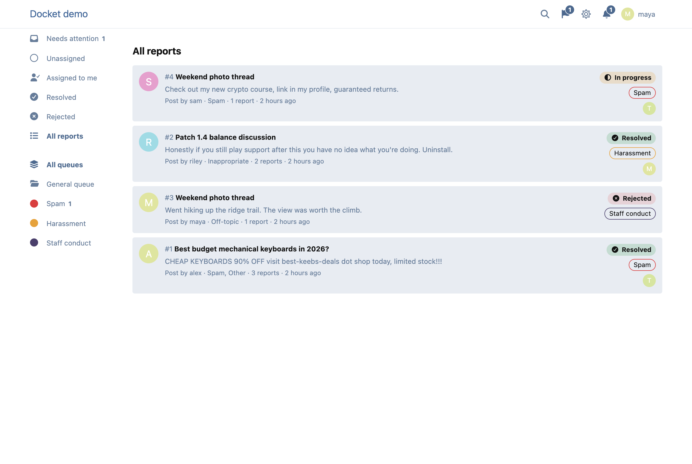
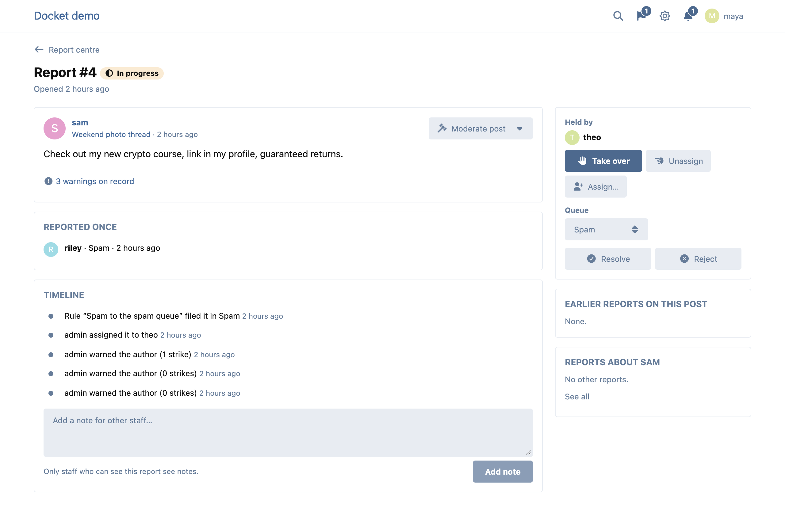
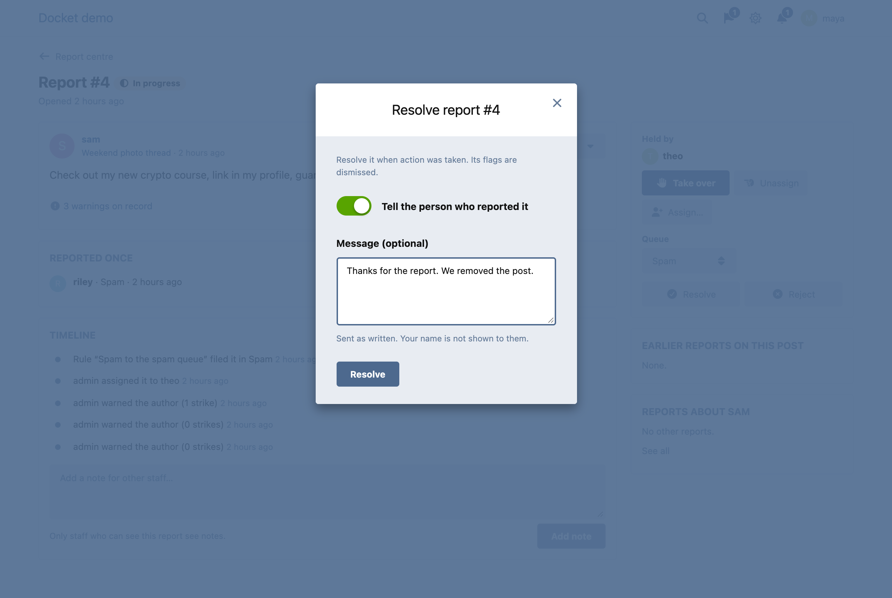
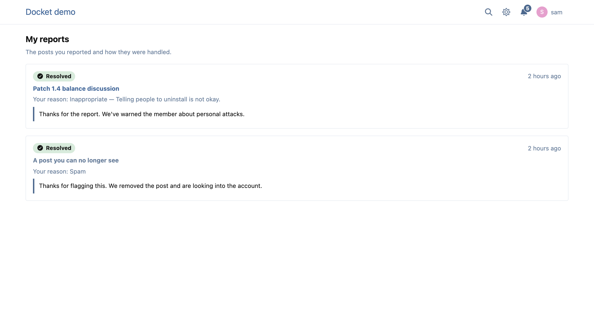
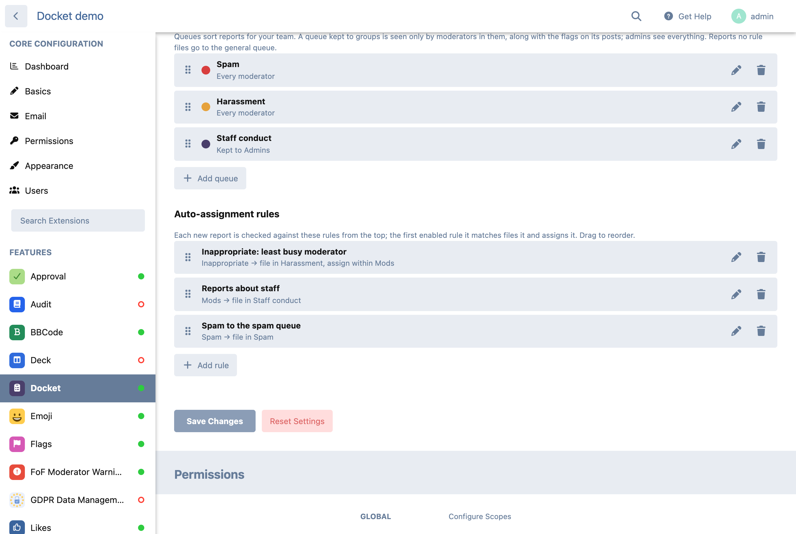

# Docket

A report centre for Flarum 2, built on [Flags](https://github.com/flarum/flags).

Flags tells your moderators that a post was reported. Docket turns each report into a case your team can work: sort it into a queue, give it to someone, write notes on it, close it as resolved or rejected, and tell the people who reported it how it went. Every report is kept, so the history of a post or a member is one click away.

Flags keeps working exactly as before. Docket adds to it and changes nothing it does; disable Docket and your flags are where you left them.



## What it does

- **One report per flagged post.** Every flag on the post joins it, whatever raised it: the flag form, a post waiting for approval, or an extension that flags posts. A flag after the report is closed opens a new one.
- **Report centre** at `/reports`: needs attention, unassigned, assigned to me, resolved, rejected and all, by queue, with counts.
- **Queues** that admins define, each with a colour, and optionally kept to groups. A queue kept to groups is seen only by moderators in them, together with the flags on its posts. Admins see everything.
- **Auto-assignment rules**, tried top to bottom, drag to reorder. Match on tags, reason, flag type (e.g. `approval`) or the author's groups, then file the report in a queue and assign it to a moderator, or to whichever member of a group has the fewest reports in hand.
- **Claim, release, take over and assign.** A report someone holds is in progress; one nobody holds is open. Assigning to someone else needs the *Assign reports to other moderators* permission, and is refused if they can't see the report.
- **Resolve or reject.** The post's flags are dismissed with it. Optionally tell the people who reported it, with a message of your own; your name is never shown to them.
- **Staff notes and a timeline** on every report: who claimed it, who it was assigned to, the rule that filed it, and what happened to the post (hidden, restored, deleted, approved) or its author (warned, suspended).
- **History**: earlier reports on the same post and about the same member on every report, and a *Reports* tab on each member's profile for staff, with two lists: the reports *about their posts* and the reports *made by them*.
- **A reporter's record**, for staff: how many reports a member made in the last 30 days, 90 days, 12 months and all time, and how many of each were resolved, rejected or are still open. It heads their *Made by them* list, and one line of it sits beside each reporter's name on a report. It is counted the way crowd moderation weighs reporters, from the reports the viewing moderator can see.
- **My reports** at `/my-reports` for everyone: the posts you reported and how each went, as far as staff chose to tell you. Admins choose how far back it goes (forever, 30 or 90 days, 6 months or a year); older reports are not sent at all, and staff still see every one.
- **Notifications**: *a report was assigned to me* (web and email), *a report I made was reviewed* (web, email optional) and, for authors, *members' reports hid my post* (web and email).
- Dismissing flags the Flarum way, from the post or the flags dropdown, closes the report too: resolved if something was done to the post, rejected if not.
- **Crowd moderation** (off until you switch it on): when enough trusted members report a post within a few hours, it is hidden, or sent back to approval, until staff review it. See below.





## Works with

- **flarum/tags**: rules by tag, and *View flags* per tag decides which reports a moderator sees.
- **flarum/approval**: posts awaiting approval arrive as reports of type `approval`; approving one is logged.
- **fof/moderator-warnings**: warn the author from the report, see their warning count, and the warning is logged on the report.
- **flarum/suspend**: suspending the author is logged on their open reports.
- **fof/byobu** and every other extension that limits who sees a post: a report is seen only by someone who can see its post.

## Crowd moderation

When enough members report the same post, it doesn't wait for a moderator to wake up. Once the reports reach the threshold within the window, the post is hidden (or, with flarum/approval, sent back to approval) and its report waits in the report centre. A first post takes its whole discussion with it. The author is told, with the most common reason, and can still see their post. Nobody is told who reported it.

Staff restore it in one click from the report: that rejects the report, dismisses the flags, tells the author, and counts against the people who reported it. Restoring the post by hand (or approving it) counts the same. Resolving the report, or dismissing the flags, leaves the post hidden. Every automatic action, and every time the threshold was reached but the post was left alone, is a line in the report's timeline.

It is built to be hard to abuse:

- **Who counts** is up to you: a minimum account age and post count (7 days and 5 posts by default), and optionally only some groups. Reports from anyone else are filed as usual but don't count, so a batch of new accounts can't hide anything.
- **One connection counts once.** Reports sent from the same IPv4 address, or the same IPv6 /64, count as one person. Addresses are stored only as a keyed hash, and never shown. Flags raised without a request (by another extension, from a job) never count.
- **Trust.** With *Weigh reporters by their record* on, members whose past reports were upheld count for up to 1.5, members whose reports were rejected or restored for as little as 0.5, and new reporters for 1. The threshold is a total of those weights, and is never met by fewer than two people.
- **Never hidden**: posts by staff (anyone who can see flags or hide posts) and by the groups you choose. Reports that would have hidden them are logged and left for you.
- **Cool-down**: a post staff restored isn't hidden by reports again for a while (24 hours by default).
- **Thresholds by tag and by queue**: give a tag its own number, or 0 for never; a queue's own number beats the tags.
- **One action, however many reports arrive at once.** The post's row is locked while each report is counted, so a burst of reports hides it once.
- Everything is decided on the server. None of the settings are sent to the forum.

**Behind a proxy.** Flarum sees the address of whatever connects to it. When that is a proxy on the same machine or private network (Docker, a local nginx), Docket reads the address the proxy appended to `X-Forwarded-For`, from the right, and ignores anything the visitor sent before it. Behind Cloudflare, restore visitor addresses in your web server (nginx `real_ip`); otherwise everyone shares a few Cloudflare addresses and reports count for less, never more.

**Alternate accounts.** An extension that detects alternate accounts can bind its own `ErnestDefoe\Docket\Crowd\LinkedAccounts` in the container; accounts it links count as one person.

## Who sees what

A report is seen by exactly the people who see the flags on its post: the post must be visible to them (private discussions, restricted tags, hidden and unapproved posts all count), and they need *View flags* for its tags. A queue kept to groups narrows that further. A report whose post has been deleted is kept for staff who hold *View flags* forum-wide.

A member's reports and record are for staff who can see flags; anyone else asking for them is refused, so nobody learns from them who reported whom.

The people who reported a post see only their own report: its status, and the outcome message when staff chose to send one. They never see staff notes, other reporters, or who handled it.



## Install

```bash
composer require ernestdefoe/docket
php flarum extension:enable ernestdefoe-docket
```

Flags raised before Docket was installed, or while it was disabled, are filed the next time someone opens the report centre.

## Update

```bash
composer update ernestdefoe/docket
php flarum migrate
php flarum cache:clear
```

## Settings

*Admin → Docket*: how far back *My reports* goes, queues (each with an optional crowd threshold), rules, crowd moderation, and whether the *tell the reporters* box starts ticked. The *Assign reports to other moderators* permission is in the Moderate section of the permission grid (Moderators by default).



## Support

[Support discussion](https://ernestdefoe.online) · [Issues](https://github.com/ernestdefoe/docket/issues)

☕ If you like the things I have built, consider [buying me a coffee](https://buymeacoffee.com/ernestdefoe).
